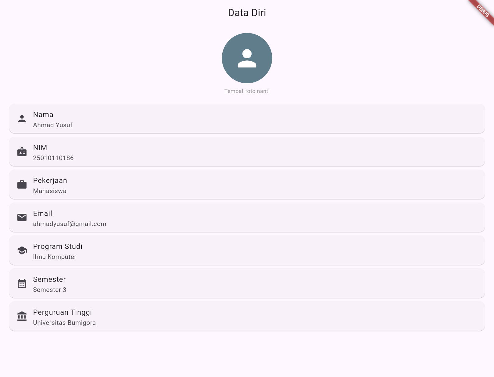
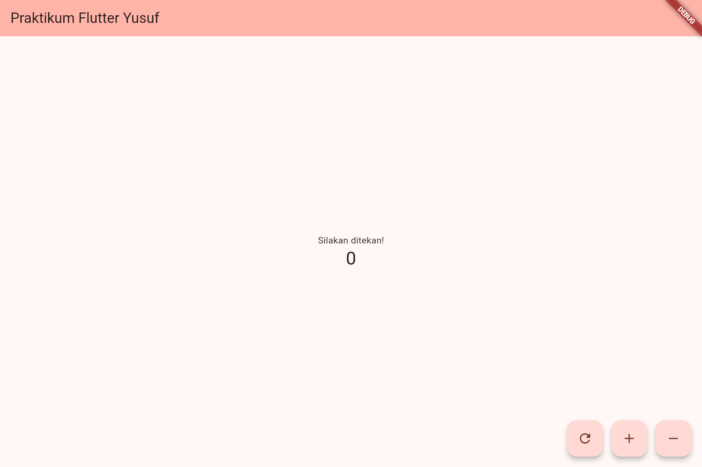
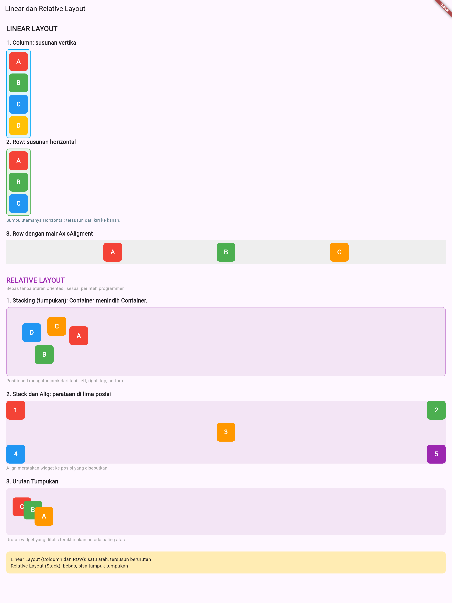
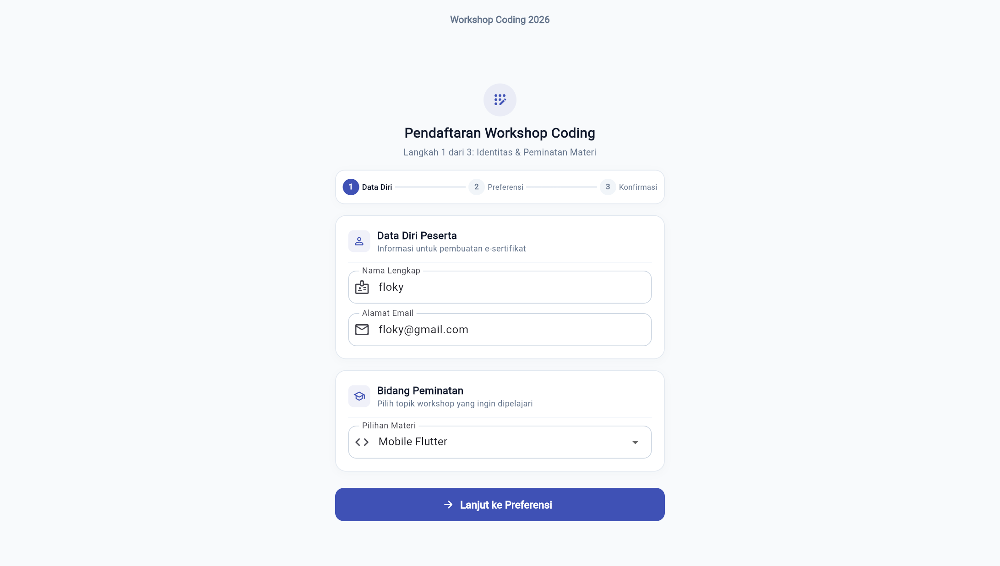
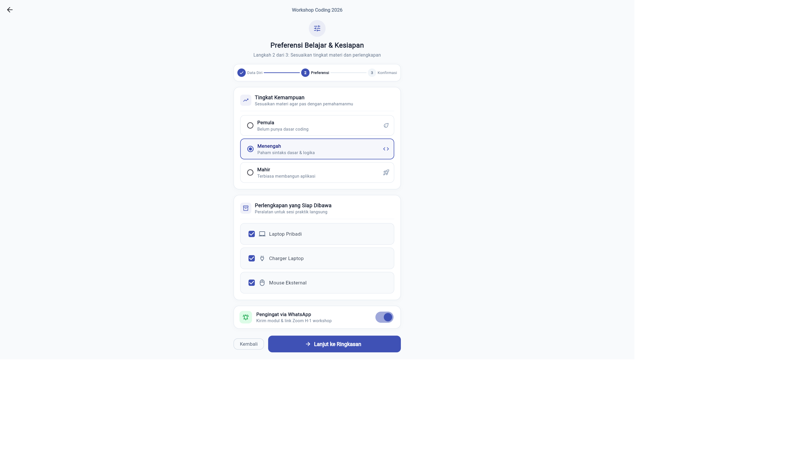
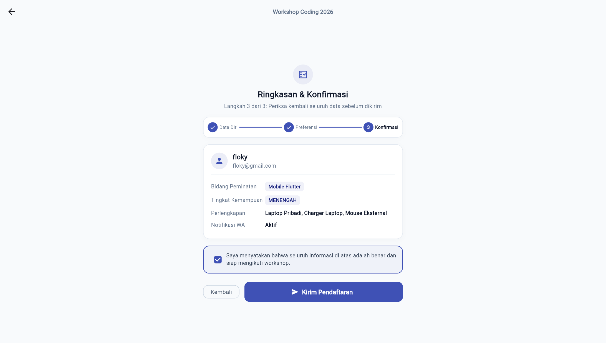
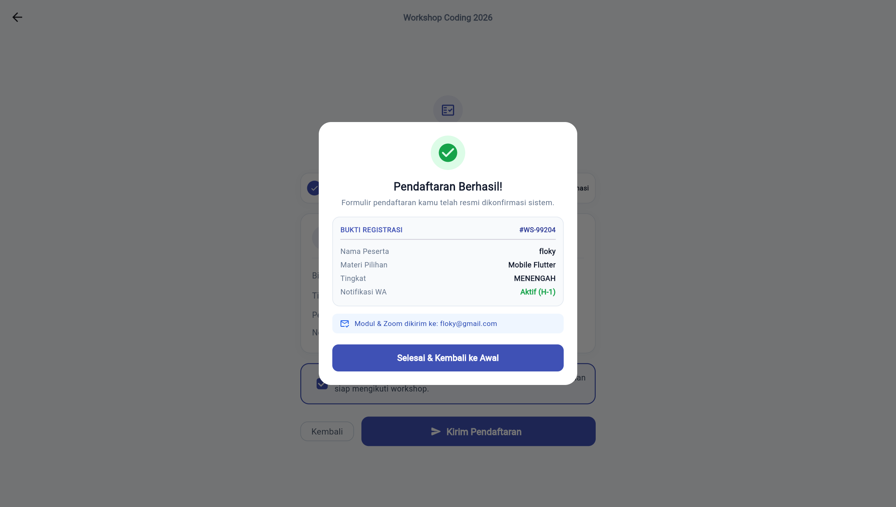

# Dokumentasi Praktikum Pemrograman3 (Flutter)

Repositori ini berisi tugas dan praktikum mata kuliah **Pemrograman 3 (Mobile)** menggunakan Flutter.

---

## 👤 Identitas Mahasiswa

- **Nama**: Ahmad Yusuf
- **NIM**: 25010110186
- **Program Studi**: S1 Ilmu Komputer
- **Semester**: 3
- **Kampus**: Universitas Bumigora

---

## 📝 Ringkasan Praktikum

### 📌 Pertemuan 01: UI Biodata Diri (StatelessWidget)
* **Fokus**: Pengenalan dasar Flutter dan pembuatan antarmuka statis (*Stateless*).
* **Yang Dilakukan**:
  * Membuat halaman profil data diri pada berkas `view/data_diri.dart`.
  * Menampilkan foto profil menggunakan `CircleAvatar`.
  * Menampilkan informasi diri (Nama, NIM, Pekerjaan, Email, Prodi, Semester, Kampus) secara rapi menggunakan kombinasi widget `Card`, `ListTile`, dan `Icon`.
* **Screenshot**:
  <br>
  

---

### 📌 Pertemuan 02: Counter App (StatefulWidget)
* **Fokus**: Pengenalan *State Management* dasar menggunakan `StatefulWidget` dan `setState()`.
* **Yang Dilakukan**:
  * Membuat aplikasi penghitung interaktif dengan variabel nilai `_counter`.
  * Menyediakan 3 tombol kontrol (*FloatingActionButton*):
    * **Tambah (`+`)**: Menaikkan angka (`_counter++`).
    * **Kurang (`-`)**: Menurunkan angka (`_counter--`).
    * **Reset (`refresh`)**: Mengembalikan angka ke `0`.
  * Mengatur `heroTag` unik pada masing-masing tombol agar tidak terjadi konflik animasi Hero.
* **Screenshot**:
  <br>
  

---

### 📌 Pertemuan 03: Layouting (Linear & Relative Layout)
* **Fokus**: Memahami konsep tata letak antarmuka di Flutter (Linear Layout dan Relative Layout).
* **Yang Dilakukan**:
  * Membuat widget bantu `kotak` untuk memvisualisasikan posisi elemen.
  * **Linear Layout (Satu Arah)**:
    * `Column`: Menyusun elemen secara vertikal (atas ke bawah).
    * `Row`: Menyusun elemen secara horizontal (kiri ke kanan) serta eksplorasi perataan dengan `mainAxisAlignment: MainAxisAlignment.spaceEvenly`.
  * **Relative Layout (Tumpukan / Bebas)**:
    * `Stack`: Menumpuk elemen satu di atas yang lain.
    * `Positioned`: Mengatur koordinat elemen berdasarkan jarak tepi (`top`, `left`, dll).
    * `Align`: Menempatkan elemen ke arah/sudut tertentu (`topLeft`, `center`, `bottomRight`, dll).
    * Menguji konsep urutan lapisan tumpukan (elemen yang ditulis terakhir akan tampil paling depan).
* **Screenshot**:
  <br>
  

---

### 📌 Pertemuan 04: Form Input & Navigasi Multi-Halaman
* **Fokus**: Penerapan berbagai komponen input form, kontrol seleksi (*selection controls*), pengiriman data (*passing data*) antar halaman, dan dialog konfirmasi.
* **Yang Dilakukan**:
  * **Model Data Bersama**: Menggunakan class `DataPendaftaran` untuk menampung dan mentransfer data formulir antar layar.
  * **Halaman 1 (Identitas & Peminatan)**: Validasi formulir (`FormState`), input teks (`TextFormField` untuk Nama & Email), dan menu dropdown (`DropdownButtonFormField`).
  * **Halaman 2 (Preferensi & Kesiapan)**: Pilihan tingkat keahlian (`RadioGroup` / `Radio`), pilihan multi-perlengkapan (`Checkbox`), dan sakelar notifikasi WhatsApp (`Switch`).
  * **Halaman 3 (Ringkasan & Konfirmasi)**: Menampilkan review seluruh data pendaftaran, validasi checkbox persetujuan syarat, dan popup bukti registrasi berhasil (`showDialog` / E-Pass) serta tombol kembali ke awal (`Navigator.popUntil`).
* **Screenshot**:

  | Langkah 1: Identitas & Peminatan | Langkah 2: Preferensi & Kesiapan |
  | :---: | :---: |
  |  |  |
  | **Langkah 3: Ringkasan Data** | **Dialog Bukti Registrasi (E-Pass)** |
  |  |  |

---

## 📂 Struktur Proyek Terpadu

Seluruh modul praktikum telah disatukan ke dalam satu aplikasi Flutter terpadu dengan sistem dashboard navigasi:

```text
lib/
├── main.dart                  # Titik masuk aplikasi & tema
├── menu_utama.dart            # Dashboard navigasi utama
└── widget/
    ├── pertemuan01/           # Praktikum 01: UI Biodata Diri
    ├── pertemuan02/           # Praktikum 02: Counter App
    ├── pertemuan03/           # Praktikum 03: Linear & Relative Layout
    └── pertemuan04/           # Praktikum 04: Form Input & Navigasi Multi-Halaman
```

---

## 🚀 Cara Menjalankan

1. Pasang dependensi Flutter:
   ```bash
   flutter pub get
   ```

2. Jalankan aplikasi:
   ```bash
   flutter run
   ```

3. Pada layar aplikasi, pilih tombol pertemuan yang ingin diuji langsung dari **Menu Utama**.
